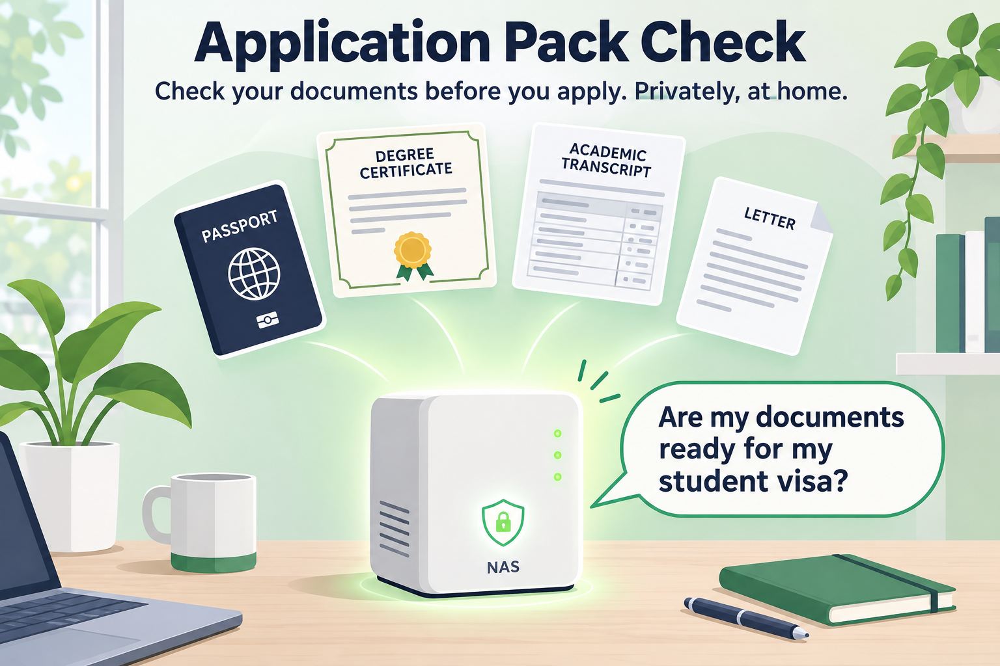
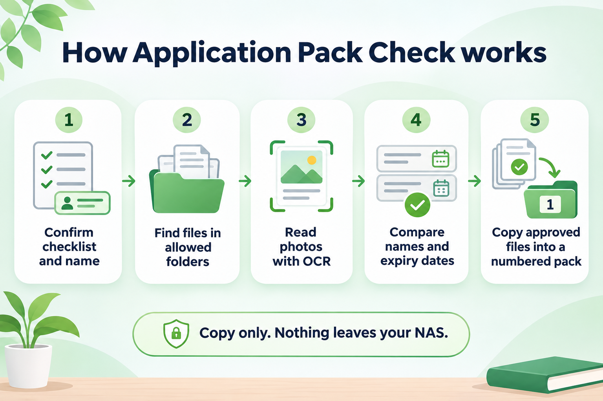
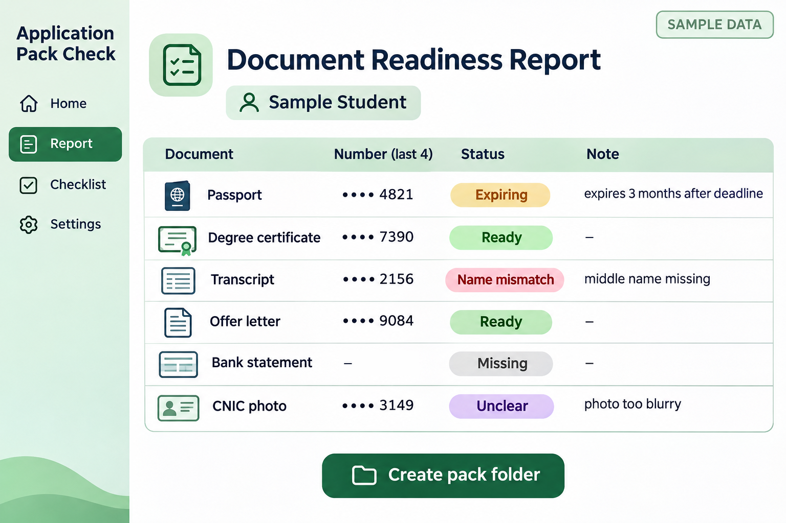

# Application Pack Check

A Skill for Uliya on the UGREEN AI NAS that checks your visa or scholarship documents before you apply, privately on your own NAS.

Ask Uliya: "Are my documents ready for my student visa?"

## What it does

1. Confirms your checklist, your name as written on your passport, and your submission date.
2. Finds documents only in the folders you allow, and reads photos of documents with OCR.
3. Extracts names, dates of birth and expiry dates and compares them across every document.
4. Gives one status per item: Ready, Expiring, Expired, Name mismatch, Unclear or Missing.
5. After you approve, copies the chosen files into a numbered pack folder and saves the report inside it.

Originals are never moved or deleted, nothing leaves the NAS, and document numbers show only their last four characters.

## Files

- `application-pack-check/SKILL.md`: the orchestration Skill (file-agent, photo-agent, document-agent, knowledge-agent)
- `application-pack-check/references/`: checklist starters, report format and user guide

Built with the official uliya-skill-kit; passes the official checker with 0 errors and 0 warnings.

## Install

Copy the `application-pack-check` folder into Uliya's Skills folder on the NAS.

## AI use

Built with help from Claude (Anthropic) for writing and checking SKILL.md.

## License

MIT
